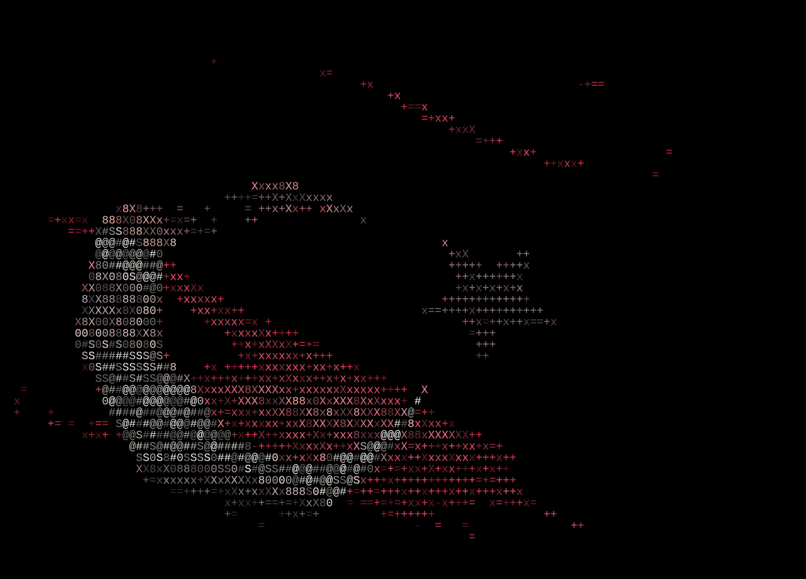

  

<h1 align="center">Emre</h1>

  Python Geliştirici &nbsp;|&nbsp; Sistem & Ağ Altyapısı &nbsp;|&nbsp; Siber Güvenlik (Yeni Başlangıç)

  

---

## Hakkımda

Donanım ve sistem altyapısı tarafından gelen, yazılım geliştirme ve siber güvenliğe yönelen bir geliştiriciyim. Sunucu kurulumu, IP kamera ve ağ sistemleri üzerine pratik deneyimim var. Bunun yanında Django ile web uygulamaları geliştirdim, Python ile veri işleme ve AI agent entegrasyonu projeleri yaptım. Şu anda siber güvenlik temellerine ve C++ diline odaklanıyorum.

## Uzmanlık Alanları

| Alan | Detay |
|------|-------|
| **Backend Geliştirme** | Django, MySQL, REST yapıları |
| **Veri İşleme & Otomasyon** | Python ile veri işleme ve otomasyon betikleri |
| **AI Entegrasyonu** | AI agent tabanlı projeler ve entegrasyonlar |
| **Sistem & Altyapı** | Sunucu kurulumu, IP kamera sistemleri, Ubuntu Server |
| **Siber Güvenlik** | Temel kavramlar, Kali Linux ile pratik çalışmalar (öğrenme aşamasında) |

## Teknoloji Yığını

  

**İşletim Sistemleri:** Ubuntu Server, Arch Linux, Kali Linux

## Şu An Odaklandığım Konular

- Siber güvenlik temelleri
- C++ programlama
- AI agent mimarileri ve entegrasyonu

## Öne Çıkan Projeler

| Proje | Açıklama | Teknolojiler |
|-------|----------|--------------|
| [Proje Adı 1](https://github.com/m-emrekalay/repo-adi) | Kısa açıklama | Django, MySQL |
| [Proje Adı 2](https://github.com/m-emrekalay/repo-adi) | Kısa açıklama | Python |
| [Proje Adı 3](https://github.com/m-emrekalay/repo-adi) | Kısa açıklama | Python, AI |

## GitHub İstatistikleri

  
  

## İletişim

  
  <!-- Aşağıdaki satırların yorumunu kaldırıp bilgilerini yaz
  
  
  -->

